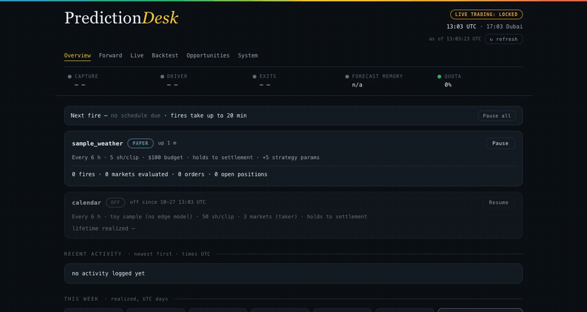
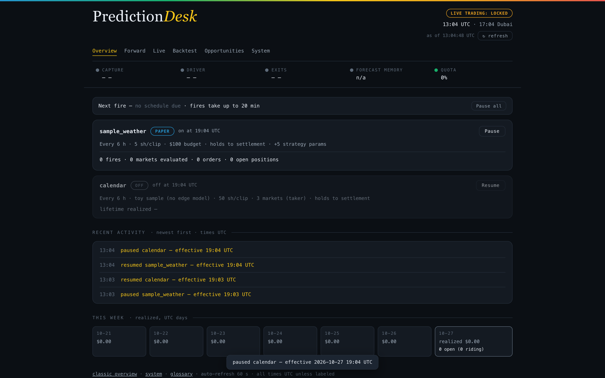

<!--
  GitHub metadata set alongside this README (GitHub search reads ONLY name/description/topics, not this file):
  About description: "PredictionDesk: an agent trading desk for prediction markets. One engine runs backtest, paper and live on Polymarket — so your backtest is a claim about what live would have done."
  Topics: polymarket, prediction-markets, paper-trading, trading-bot, agentic-trading, trading-agents, agent-trading-desk, ai-agents, mcp, backtesting, algotrading, python, claude
-->

<h1 align="center">PredictionDesk</h1>

<p align="center"><strong>An agent trading desk for prediction markets.</strong><br>
Idea → backtest → paper → live P&L, in days. Your agent writes the strategy; the desk runs it around the clock.</p>

<p align="center">
  <a href="https://github.com/stranger00135/PredictionDesk/stargazers"></a>
  <a href="LICENSE"></a>
  <a href="https://github.com/stranger00135/PredictionDesk/actions/workflows/eval.yml"></a>
  
</p>



**I ran this desk live on Polymarket: $200 → $236 in 5 days (+18%), small clips, settled on-chain.** <!-- P&L screenshot slot: docs/assets/pnl-5days.png · 2-minute demo video link under it --> That run is real and it is mine, not a promise — your P&L is your strategy's. What the desk contributes is everything around the strategy: 24/7 market capture, one engine running backtest, paper, and live on the identical code path (the Polymarket paper-trading sandbox that doesn't exist upstream), exits that manage themselves, and a Mission Control console watching it around the clock. Runs on a laptop: Python, `make demo`, supervisord.

## Quickstart

```bash
git clone https://github.com/stranger00135/PredictionDesk
cd PredictionDesk
make demo
```

That is the whole quickstart. The only prerequisite is Python 3.11+ (`make demo` checks and tells you if yours is older); everything else installs into a local `.venv` inside the clone, which every other `make` target picks up automatically — no activation needed. The repo ships two sample strategies so you have a working desk to poke at before writing any code: `sample_calendar` is enabled out of the box and trades on the order books the desk captures, and `sample_weather` ships disabled until its weather capture lane is configured (see `docs/running.md`). No venue account, no API keys, no real orders: everything starts in paper mode, and live stays locked behind the gates described below.

## Strategy to live P&L in days

The +18% run above took five days end to end. The loop the desk gives you: day 1, `make demo`, point Claude Code (or any coding agent) at `AGENTS.md`, and your strategy scaffold is paper-trading the same afternoon. Days 2-3, backtest it against the order books the desk has been capturing and let paper runs accumulate evidence in the real fire windows. Then flip live at whatever size you choose. The desk's whole job is making that loop this short.

## Paper trading on Polymarket: the sandbox that doesn't exist

Kalshi gives you `demo.kalshi.com`. Polymarket gives you nothing. PredictionDesk's paper mode is that missing Polymarket sandbox.

And paper here is not a mock with its own bugs: paper, backtest, and live are the same engine on the same code path, with the live order gate closed. What you rehearse in paper is the code that trades.

## One engine: backtest ≡ paper ≡ live

The strategy you backtest is byte-for-byte the strategy that papers and the strategy that goes live. No "now port it to production" step, no second implementation to drift. Promotion from paper to live changes the mode and the gates, never the code.

No claim follows about returns. The identical code path means your paper results measure your strategy instead of your harness. What the strategy earns is your problem.

## Runs unattended while you sleep

Scheduled fires, self-managing exits, phone alerts over ntfy, an audit trail of every action — the desk is built so an agent-written strategy can run overnight without you watching it. Real money sits behind gates you control:

| Gate | Behavior |
|---|---|
| Env flag | Live trading is off unless explicitly armed in the environment |
| Reconciliation PASS | A reconciliation evaluator must issue a scoped, time-boxed PASS; expired or absent means no live orders |
| Geo gate | The desk checks where it is running before it will arm |
| Per-order caps | Every order is capped; no single order can exceed its limit |

On top of the gates:

- **Sealed strategy configs.** Every strategy config row carries a sha256 seal. If a seal fails to verify, the desk refuses to trade that config. An agent (or anyone else) that tampers with a config takes the strategy out of the game, not into it.
- **HARD eval gates.** The recon/eval suite (`make eval-fast`) is a hard gate, not a dashboard metric.
- **Audit everywhere.** Pause/resume and the control API are audited. The desk keeps receipts.

## What is an Agent Trading Desk (ATD)?

A trading bot is one strategy wired to a venue. A trading agent framework hands an LLM tools and lets it trade. An **Agent Trading Desk** inverts the trust: agents do the work, and the desk owns the risk controls, so nothing an agent writes or says can arm live trading by itself.

Concretely, in PredictionDesk:

- Coding agents (Claude Code and friends) scaffold and maintain strategies; the repo's `AGENTS.md` tells them how to build a tenant.
- The engine, the gates, the seals, and the audit trail sit outside the agents' reach.
- Over MCP, agents and assistants get read access and an audited pause/resume, never live-arming.

That split is what makes agentic trading sane: probabilistic reasoning upstream, deterministic fail-closed execution downstream.

## Write a strategy, or have an agent write it

A strategy is a plugin:

```
strategies/<name>/
  manifest.json      # what it trades, when it fires
  strategy.py        # generate_orders(store, **ctx)
```

```python
def generate_orders(store, **ctx):
    ...
```

Point Claude Code (or any coding agent) at `AGENTS.md` and it scaffolds the tenant for you. The bundled weather tenant and toy calendar strategy are the reference implementations. Before anything goes near live, the config gets sealed and the eval suite has to pass.

## Mission Control

A web console for the humans supervising the desk:

- Health strip across the top
- Four-state mode chips: `PAPER` / `LIVE` / `LIVE-LOCKED` / `OFF`
- Audited pause/resume
- Activity feed
- Weekly P&L



Behind it sits an audited control API, and ntfy pushes alerts to your phone.

## MCP: drive the desk from Claude

PredictionDesk ships an MCP server, so Claude or any MCP client can sit at the desk: read health and events, pause and resume (audited).

What MCP trading access deliberately excludes: arming live mode. There is no live-arming over MCP, by design. Your assistant can watch the desk and stop it; it cannot bet your money.

## What's in the box

| Piece | Job |
|---|---|
| Capture | 24/7 order books and trades to parquet |
| Driver | Runs strategies in scheduled fire windows |
| Exit monitor | Take-profit / stop-loss on open positions |
| Recon / eval suite | HARD gates; `make eval-fast` |
| Mission Control | Health strip, mode chips, activity feed, weekly P&L |
| Control API | Audited pause/resume and desk control |
| MCP server | Desk access for Claude / any MCP client |
| Alerts | ntfy |
| Glossary | The desk's vocabulary, defined |
| Ops | supervisord; runs on a laptop |

## What this repo is, and is not

This is the workbench: capture, engine, gates, console, audit trail, plus a sample weather tenant and a toy calendar strategy as teaching examples.

It is not the alpha. My private strategies are not in this repo, and I won't pretend otherwise. The +18% at the top is my own run at small size, shown because it is real — not a promise, and not reproducible from the bundled examples, which exist to show the plumbing, not an edge. You bring the strategy, or let your agents bring it, and the desk makes sure trying it can't cost more than you allowed.

Prediction markets trade real money. Nothing in this repository is financial advice.

## Contributing

Solo-maintained. Issues and PRs welcome; expect honest triage rather than SLAs.

<!-- OPEN pre-flip requirement (Tiger ruling 2026-10-27): Open-Meteo CC BY 4.0 attribution for the
     sample tenant — wording/placement owned by marketing, signs off before the flip. MIT LICENSE
     file + badge already ship. Previous wording candidate: "MIT — see LICENSE. Weather forecasts
     in the sample tenant come from the Open-Meteo API (data under CC BY 4.0; the free API tier is
     for non-commercial use — real-money deployments should use a paid plan). Market data comes
     from Polymarket's public Gamma/CLOB/Data APIs." -->
